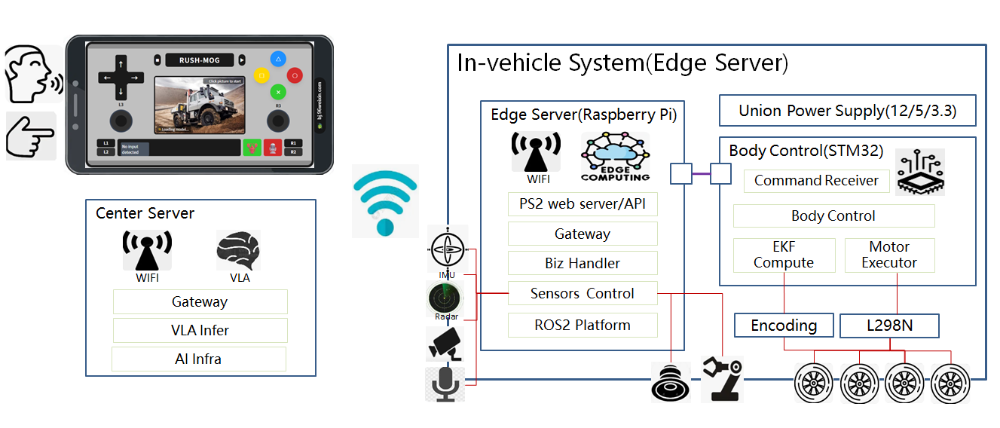
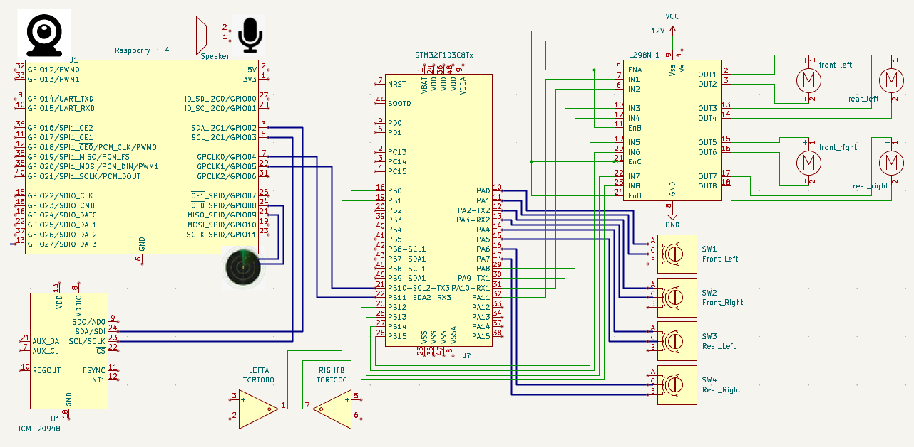
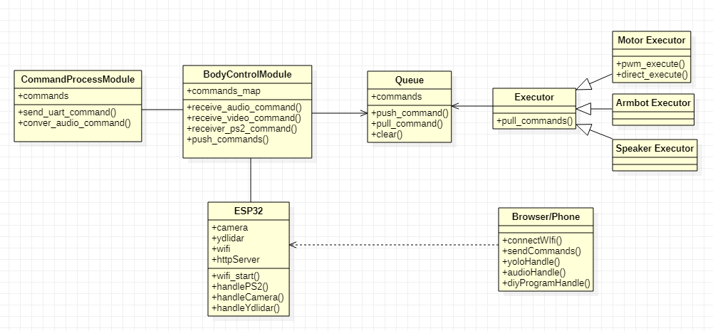
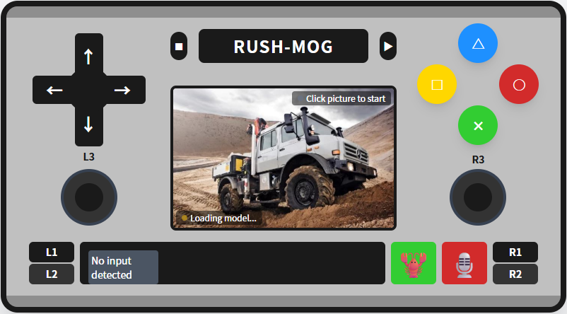
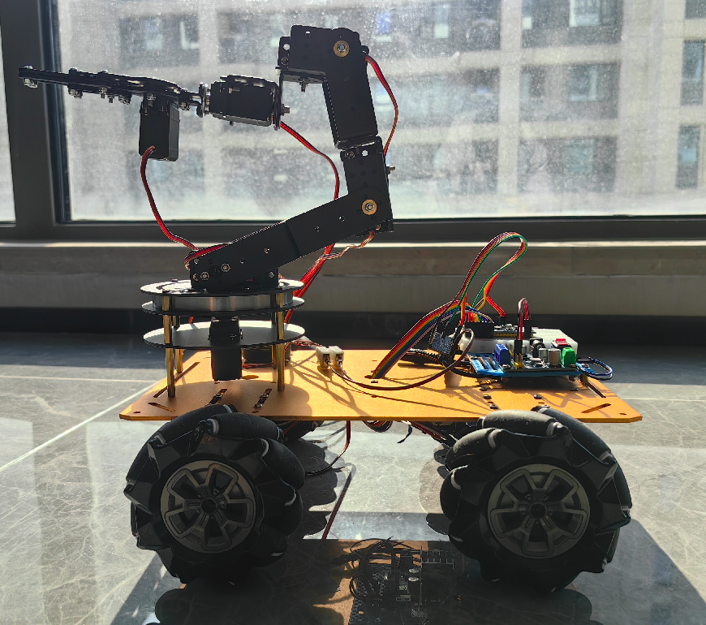

# Rush Mog

[中文版](README_cn.md)

Rush Mog is an intelligent omnidirectional wheel car controlled by VLA (Vision-Language-Action), inspired by the Unimog. Based on ESP32 + STM32F103 + L298N + OV2640 + LiDAR, it supports three control modes: a mobile phone Wi-Fi PS2 emulator, voice control, and VLA intelligent control. It also supports robotic arm operations and audio playback. Additionally, it provides action programming, allowing users to customize combined action commands.

The v2 roadmap adds **2D LiDAR SLAM mapping, autonomous navigation, and object search**, with **ICM-20948** (9-axis IMU) for localization. These require an onboard Linux computer (Raspberry Pi 4B/5 or Jetson Orin Nano); the ESP32-S3 cannot run ROS2/slam_toolbox/Nav2. See [Hardware SLAM/Nav Plan](hardware/SLAM_NAV.md).

## Features
#### (1) Mobile Phone PS2 Emulator for Car Control
Use your phone as a PS2 emulator to control the car to move forward, backward, turn left, turn right, strafe left, strafe right, move diagonally forward-left, forward-right, backward-left, and backward-right.

#### (2) Camera Monitoring & Automatic Object Recognition
Monitor and automatically identify and classify objects via the onboard camera. View the live feed in real-time on the mobile phone PS2 controller interface.

#### (3) Voice Control for Car Movement
Use the voice control button on the mobile PS2 controller to command the car to move forward, backward, turn left, turn right, strafe left, strafe right, and move in diagonal directions.

#### (4) Audio Playback
Play V8 engine sounds through the onboard MP3 player for a thrilling audio experience.

#### (5) Action Programming
A programming interface is provided to script audio effects and car movements, enabling various choreographed sequences.

#### (6) SLAM Mapping, Autonomous Navigation & Target Seeking
Build a 2D occupancy map with LiDAR + wheel odometry + ICM-20948, localize with AMCL/EKF, navigate to goals with Nav2 or the built-in direct controller, and search for target objects using camera detection + LiDAR ranging + frontier exploration. The robot returns the target pose and approaches it at a configurable standoff distance.

#### (7) Object Handling
Use the VLA model to control car movement, enabling searching, locking onto, and tracking target objects. Use the robotic arm to grasp, transfer, and place objects into designated areas. The transport path can be pre-planned or automatically learned.

## Design Overview
#### Overall System Architecture

Design principles:
- 1 ESP32 implements a web server, providing the PS2 control page, voice input, Wi-Fi AP, and MJPEG video bridge.
- 2 ESP32 receives PS2 commands and directly forwards them to STM32 for execution.
- 3 ESP32 receives voice commands, recognizes them, converts them into instructions, and forwards them to STM32.
- 4 An onboard Linux computer (Raspberry Pi 4B/5 or Jetson Orin Nano) runs ROS2: LiDAR/camera drivers, EKF, slam_toolbox, Nav2, and the center_server navigation/search nodes. It consumes the camera feed (directly or from the ESP32 bridge) and publishes velocity commands.
- 5 STM32 acts as the car's real-time control center, translating operation commands into GPIO/PWM for the L298N motor driver or the robotic arm. For SLAM/navigation, an upgraded MCU (F103RCT6/F411) is recommended for 4-wheel encoders and 4 independent PWM channels.

#### Hardware Architecture
- DIY car using 97mm omnidirectional wheels with JGB37-520 motors (hall encoders), driven by an L298N driver board (4WD, or two 2WD boards). For navigation, replace it with a 4-channel driver (TB6612/DRV8871/BTS7960) for independent wheel speed control.
- Car body control uses an STM32F103C8T6 board; an F103RCT6/F411 is recommended for encoder + PWM headroom.
- Wi-Fi and video bridging use an ESP32-S3-CAM + OV2640 camera.
- SLAM/navigation use a 2D LiDAR (LD19/LD06 or RPLIDAR A1) and an ICM-20948 9-axis IMU, both connected to the onboard Linux computer (or the IMU to the STM32).
- A Raspberry Pi 4B/5 or Jetson Orin Nano is required on the robot to run ROS2/slam_toolbox/Nav2.

For details, see: [Hardware Design Notes](hardware/README.md) and [SLAM/Navigation Hardware Plan](hardware/SLAM_NAV.md).

#### Software Architecture
- The software is divided into the vehicle control subsystem and the center inference/navigation subsystem.
- The vehicle control subsystem runs on the STM32 board, driving the car motors, robotic arm, and audio output. It receives and executes commands from the onboard computer/bridge.
- The onboard Linux subsystem runs ROS2 drivers, `base_bridge_node`, ICM-20948, EKF, slam_toolbox, Nav2, target detection, and object search.
- The center_server v2 adds SLAM map management, localization health gating, autonomous navigation, target detection/search/approach, velocity arbitration, and STM32 serial bridge. See [center_server DESIGN](software/center_server/DESIGN.md).

For details, see: [Software Design Notes and Code](software/README.md)

## How to Use the Controller

After starting the car, connect your phone to the RUSH-MOG Wi-Fi network created by the ESP32-S3-CAM. Once connected, open your phone's browser and go to 192.168.4.1 to access the PS2 controller page and operate the car.

## Final Product Showcase

## Tips & Cautions
1 Do not place the microphone on the car. The car's motors are loud when running, making voice recognition difficult.
