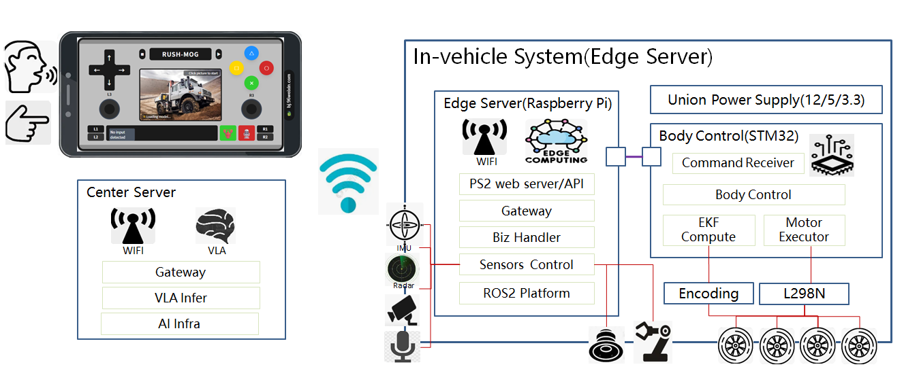
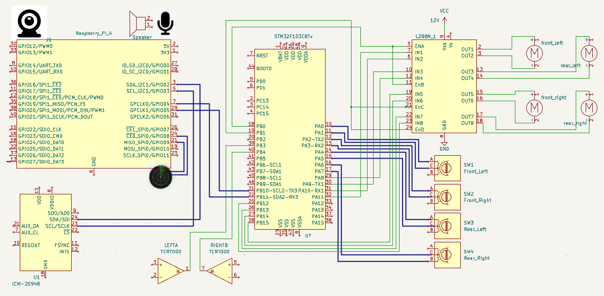
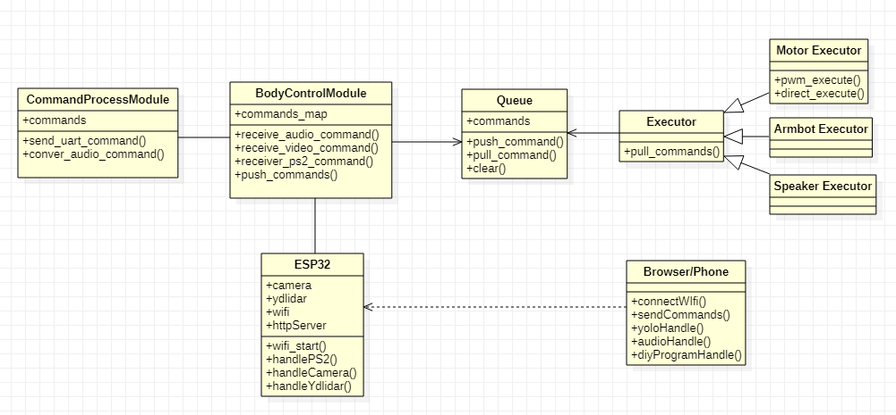
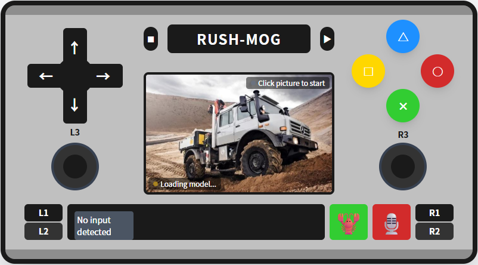
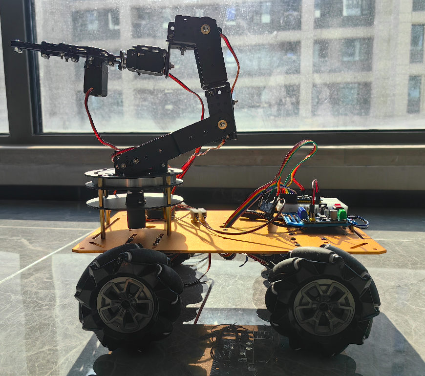

# Rush Mog

[English Version](README.md)

Rush Mog是一款致敬Unimog的VLA控制的智能万向轮小车。基于esp32 + stm32f103 + L298N + ov2640 + 激光雷达，实现支持手机WIFI的PS2模拟器、语音控制和VLA智能控制三种模式，并支持机械臂操作和声音外放的智能小车。同时提供动作编程，可自定义组合效果的动作指令。

v2 目标增加 **2D 激光 SLAM 建图、自主导航、目标搜索**，并增加 **ICM-20948** 九轴 IMU 做定位。这些能力需要机载 Linux 计算平台（树莓派 4B/5 或 Jetson Orin Nano）；ESP32-S3 不能跑 ROS2/slam_toolbox/Nav2。硬件方案见 [硬件 SLAM/导航方案](hardware/SLAM_NAV.md)。

## 功能说明
#### （1）手机模拟PS2控制小车行驶
可通过手机模拟PS2控制小车前进、后退、左转、右转、向左横向行驶，向右横向行驶，向左前、右前、左后、右后方向行驶。

#### （2）摄像头监控及自动识别物体
通过车载摄像头监控和自动识别、分类物体。并将画面实时在手机模拟的PS2控制器上查看。

#### （3）语音控制小车行驶
可通过手机模拟PS2控制器中的语音控制键控制小车前进、后退、左转、右转、向左横向行驶，向右横向行驶，向左前、右前、左后、右后方向行驶。

#### （4）外放炸街
通过车载MP3播放V8发动机声音实现炸街效果。

#### （5）动作编程
提供编程页面，对炸街效果、小车动作进行编程，实现各种编排效果。

#### （6）SLAM建图、自主导航与自动寻找目标
通过 2D 激光 + 轮式编码器 + ICM-20948 建立占据栅格地图，使用 AMCL/EKF 定位；通过 Nav2 或内置直航导航到目标点；通过相机检测 + 激光测距 + 前沿探索搜索目标物体，返回目标位姿并保持设定距离接近。支持地图保存/加载、建图任务、探索任务和目标搜索任务。

#### （7）搬运物体
使用VLA模型控制车体移动，可以根据目标物体进行搜索、锁定，并对移动目标物体进行跟踪。使用机械臂对物体进行夹起、转移、放下到指定范围区域等动作，实现物体搬运。搬运路径可规划也可自动学习。

## 设计说明
#### 总体系统架构

设计原理：
- 1 通过esp32实现web server，提供PS2控制页面、语音输入、WIFI AP 和 MJPEG 图传桥。
- 2 esp32接收PS2指令直接下发stm32进行操作。
- 3 esp32接收语音指令进行识别，转换指令后下发stm32进行操作。
- 4 机载 Linux 计算平台（树莓派 4B/5 或 Jetson Orin Nano）运行 ROS2：激光/相机驱动、EKF、slam_toolbox、Nav2，以及 center_server 的导航/搜索节点。它消费相机画面（直连或经 ESP32 桥接）并发布速度指令。
- 5 stm32作为车体实时控制中心，将操作指令转换为具体的GPIO电位或PWM，对接L298N驱动小车电机，或对接机械臂驱动，执行命令。SLAM/导航目标建议升级为 F103RCT6/F411，以支持 4 路编码器和 4 路独立 PWM。

#### 硬件架构设计
- DIY小车，使用97mm万向轮加JGB37-520电机（带霍尔编码器），L298N驱动板(四驱的，或者用两个两驱的)。导航目标建议换四路独立 PWM 驱动（TB6612/DRV8871/BTS7960）。
- 车体控制使用STM32F103C8T6单板；增加编码器/PWM 余量建议升级 F103RCT6/F411。
- WIFI及图传使用ESP32-S3-CAM + OV2640摄像头。
- SLAM/导航使用 2D 激光雷达（LD19/LD06 或 RPLIDAR A1）+ ICM-20948 九轴 IMU，接机载 Linux 计算平台（IMU 也可接 STM32）。
- 车上必须有树莓派 4B/5 或 Jetson Orin Nano 才能跑 ROS2/slam_toolbox/Nav2。

详细参照：[硬件设计说明](hardware/README.md)、[SLAM/导航硬件方案](hardware/SLAM_NAV.md)

#### 软件架构设计
- 软件分车体控制子系统和中心推理/导航子系统。
- 车体控制子系统，由STM32单板承载，驱动小车电机、机械臂、外放，接机载计算机/桥接命令进行执行。
- 机载 Linux 子系统运行 ROS2 驱动、`base_bridge_node`、ICM-20948、EKF、slam_toolbox、Nav2、目标检测和目标搜索。
- center_server v2 增加 SLAM 地图管理、定位健康度门控、自主导航、目标检测/搜索/接近、速度仲裁和 STM32 串口桥。详见 [center_server 设计](software/center_server/DESIGN.md)。

详细参照：[软件设计说明和代码](software/README.md)

## 手柄使用办法

启动小车后，使用手机连接RUSH-MOG WIFI。连接成功后打开手机浏览器，输入192.168.4.1，打开PS2手柄页面，操控小车。

## 成品效果

## 避坑说明
1 不要把麦放到小车上，因为小车电机声音大，开起来了声音就难识别了。