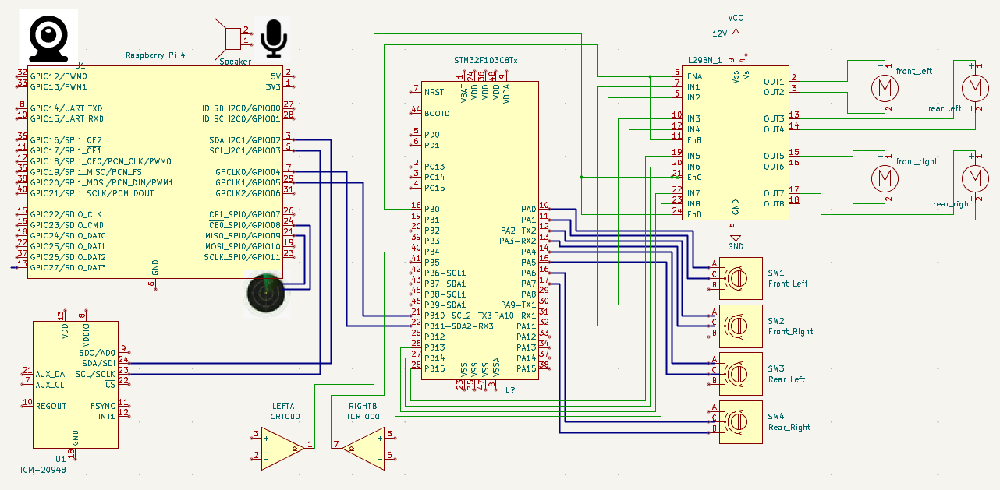
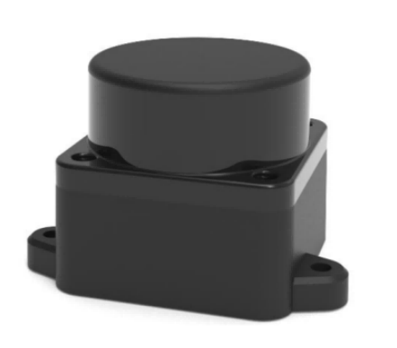
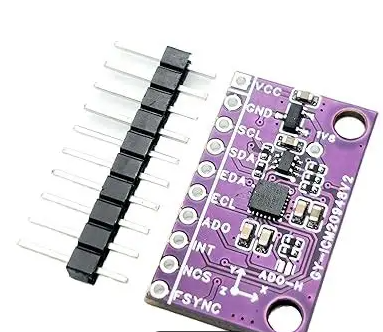

## 整体设计

其它说明：树莓派U口接摄像头。

> **SLAM/导航目标方案与硬件缺口分析见 [SLAM_NAV.md](SLAM_NAV.md)。**
> 现有车能完成遥控、语音、机械臂和视觉演示；要跑 SLAM + Nav2 + 目标搜索，必须补：
> 机载 Linux 计算平台（树莓派/Orin）、2D 激光雷达、轮式编码器闭环。
> ICM-20948 是定位链路的必要补充，但只加 IMU 不能替代激光和编码器。

## BOM清单：

| 模块          | 说明                                                         | 价格(元) |
| ------------- | ------------------------------------------------------------ | -------- |
| 1 机载计算机     | **树莓派 4B**，跑 ROS2/SLAM/Nav2         | 500      |
| 2 控制单板      | **STM32f103C8T6**控制单板，作为控制中心。                           | 15       |
| 3 2D 激光雷达    | **LD19/LD06 或 RPLIDAR A1**，360°/12m/10Hz，接树莓派 USB       | 300      |
| 4 摄像头         | Asprapro深度相机，USB口接树莓派。                                 | 139       |
| 5 陀螺仪        | **ICM-20948 9 轴 IMU**（替代 MPU6050），用于 EKF/定位             | 70       |
| 6 悬崖/碰撞      | TCRT5000 红外反射悬崖 / 防跌落模块，悬崖传感器 + 微动碰撞开关       | 20       |
| 7 小车底盘       | 金属底盘，JGB37520电机带霍尔效应编码器，麦克纳姆万向轮             | 350       |
| 8 L298N四驱板    | 四驱的L298N电机驱动。                                           | 28       |
| 9 电源及转换板    | 12V电源，要3600毫安时以上，DC接口。 12V转5V 3A和3.3V 1A转换板。    | 50       |
| 10 麦克风        | USB全向麦克风，USB口接树莓派                                       | 25       |
| 11 音箱         | 蓝牙音箱，树莓派蓝牙连接                                           | 50       |

> 目标增量预算约 ¥900–1500（不含机械臂/底盘）。详细选型、接线、引脚冲突和标定见
> [SLAM_NAV.md](SLAM_NAV.md)。

## 关键接线说明
| 左对接口      | 右对接口               | 作用说明          | 备注 |
| ------------ | ---------------------- | ---------------- | ---- |
| STM32 UART3 TX：PB10   | 树莓派 UART3 RX: GPIO5 |  Edge Server 底盘串口 | |
| STM32 UART3 RX：PB11   | 树莓派 UART3 TX: GPIO4 |  Edge Server 底盘串口 |  |
| 树莓派 UART4 TX: GPIO8   | 激光雷达 RX口 |  激光雷达SLM建图 | |
| 树莓派 UART4 RX: GPIO9   | 激光雷达 TX口 |  激光雷达SLM建图 |  |
| 树莓派 SDA IIC1: GPIO2   | ICM 20948 SDA |  陀螺仪矫正 | |
| 树莓派 SCL IIC1: GPIO3   | ICM 20948 SCL |  陀螺仪矫正 |  |
| 树莓派 USB1   | 深度相机 |  视觉SLM建模 |  |
| 树莓派 USB2   | 全向麦克风 |  语音识别控制 |  |
| 树莓派 蓝牙1   | 蓝牙音箱 |  语音外放 |  |

## 模块说明

#### 1 树莓派

树莓派 4B作为机载 ROS2 计算平台：接激光雷达、相机、ICM-20948、悬崖传感器、麦克风、音箱。
通过 UART 与 STM32 通信，运行 EKF/SLAM/Nav2 与 edge_server 的导航/搜索节点。

#### 2 控制中心-STM32单板

STM32单板作为中心控制单元，接收语音命令，转换成电机驱动指令下发到电机驱动。
同时对接树莓派，树莓派进行图像识别后传回控制指令到STM32， STM32根据指令驱动机械臂舵机。

IO口分配如下（以 `software/body_control` 固件为准）：

| GPIO         | 对接口                  | 作用说明          | 备注 |
| ------------ | ---------------------- | ---------------- | ---- |
| PA11         | 电机驱动IN1             |  左前电机控制1     | 与 USB D- 复用 |
| PA10         | 电机驱动IN2             |  左前电机控制2     | 与 USART1 RX 复用 |
| PA9          | 电机驱动IN3             |  左后电机控制1     | 与 USART1 TX 复用 |
| PA8          | 电机驱动IN4             |  左后电机控制2     | TIM1_CH1 |
| PB15         | 电机驱动IN5             |  右前电机控制1     | |
| PB14         | 电机驱动IN6             |  右前电机控制2     |  |
| PB13         | 电机驱动IN7             |  右后电机控制1     | |
| PB12         | 电机驱动IN8             |  右后电机控制2     |  |
| PB0          | 小车左侧电机使能        |  TIM3_CH3 PWM      | |
| PB1          | 小车右侧电机使能        |  TIM3_CH4 PWM      | |
| PB10         | UART3 TX接树莓派 UART3 RX: GPIO5 |  Edge Server 底盘串口 | |
| PB11         | UART3 RX接树莓派 UART3 TX: GPIO4 |  Edge Server 底盘串口 |  |
| PA0          | 小车左前电机编码器信号1  |  小车速度位置计算     |  |
| PA1          | 小车左前电机编码器信号2  |  小车速度位置计算     |  |
| PA2         | 小车右前电机编码器信号1  |  小车速度位置计算     |  |
| PA3         | 小车右前电机编码器信号2  |  小车速度位置计算     |  |
| PA4         | 小车左后电机编码器信号1  |  小车速度位置计算     |  |
| PA5         | 小车左后电机编码器信号2  |  小车速度位置计算     |  |
| PA6          | 小车右后电机编码器信号1  |  小车速度位置计算     |  |
| PA7          | 小车右后电机编码器信号2  |  小车速度位置计算     |  |
| PB3          | 小车左侧悬崖模块监测     |  防撞               | |
| PB4          | 小车右侧悬崖模块监测     |  防撞               | |

#### 3 2D 激光雷达（SLAM/导航必需）
推荐 LD19/LD06（360°, 12 m, 10 Hz）或 RPLIDAR A1。接树莓派 USB，由 ROS2 驱动发布
`/scan`。安装高度 15–25 cm，360° 无遮挡。不要经旧 ESP32 桥转发：带宽、时间戳和驱动都不合适。
详见 [SLAM_NAV.md](SLAM_NAV.md) §7。
最终采用国科光芯D6激光雷达。

#### 4 深度相机

#### 5 陀螺仪 ICM-20948 9 轴 IMU

使用 ICM-20948（9 轴，含 AK09916 磁力计）。安装在底盘中心、
刚性固定、远离电机/电池/大电流线。100 Hz 输出，用于 EKF 融合；磁力计受电机干扰时只做
慢速校正，不硬切航向。驱动和标定见 `software/edge_server/edge_server/drivers/icm20948.py`
与 [SLAM_NAV.md](SLAM_NAV.md) §6。

> ICM-20948 已进入 NRND/替代周期，新设计可评估 ICM-42688-P + 磁力计组合。

####　6　LM393 红外反射悬崖 / 防跌落模块

采用 TCRT5000 红外反射模块（板载 LM393 比较器），车头左前、右前各一只，只使用 DO 数字量输出：

| 模块 | STM32 引脚 | 说明 |
| --- | --- | --- |
| 左前悬崖 DO | PB3 | 左前方向防跌落 |
| 右前悬崖 DO | PB4 | 右前方向防跌落 |

- VCC 推荐 3.3V，GND 必须与 STM32 共地；PB3/PB4 为 5V 容忍，5V 模块也可以。
- PB3/PB4 复位后是 JTAG 的 JTDO/NJTRST，固件会关闭 JTAG、保留 SWD；ST-Link 仍可通过 SWD 烧录调试。
- DO 是电位器阈值比较输出，不能测距。要获得约 10cm 的停车余量，把探头朝前下方倾斜，让红外光斑落在车头前方约 10cm 的地面上，再用电位器把该距离调到刚好触发；装车后桌面上不触发、桌沿外触发。
- 触发后固件立即停车并封锁非后退运动，只允许 `0`（停）和 `2`（后退）退出；极性和消抖参数见 `software/body_control/src/inc/cliff_sensor.h`。

#### 7 小车底盘
小车底盘是拼多多淘的底盘+JGB37 520电机+万向轮组装。拼多多也有成套的，成套的更贵一点。

轮式编码器与轮速闭环
JGB37-520 自带霍尔编码器，现已接入 STM32 的 PA0~PA7（左前 A0/A1、右前 A2/A3、
左后 A4/A5、右后 A6/A7），固件用 EXTI 软件四倍频解码（8 路 A/B 相，无需空闲定时器），
通过 USART3（与 PS2 接收器同一串口）向树莓派 Edge Server 上报四轮速度和总里程，
dashboard 的 **BODY CONTROL** 面板实时显示。
编码器 → 轮速闭环 → `/odom` 由 `edge_server_node` 发布，可直接接入 EKF/Nav2；
详见 [SLAM_NAV.md](SLAM_NAV.md) §9。

#### 8 电机驱动模块

使用L298N电机驱动，控制小车四个电机，四驱控制。

12V输入电压，5V输出电压为控制单板等其他模块供电。

#### 9 电源及电压转换板
小车上有12V，5V， 3.3V三种电压，最好用12V供电电源，并用电压转换板转换一下。

#### 10 全向麦克风
使用NewMine音箱和麦克风合的蓝牙音箱。

#### 11 蓝牙音箱
使用NewMine音箱和麦克风合的蓝牙音箱。

## 硬件设计工具KiCAD

安装：https://docs.kicad.org/5.1/zh/getting_started_in_kicad/getting_started_in_kicad.html

