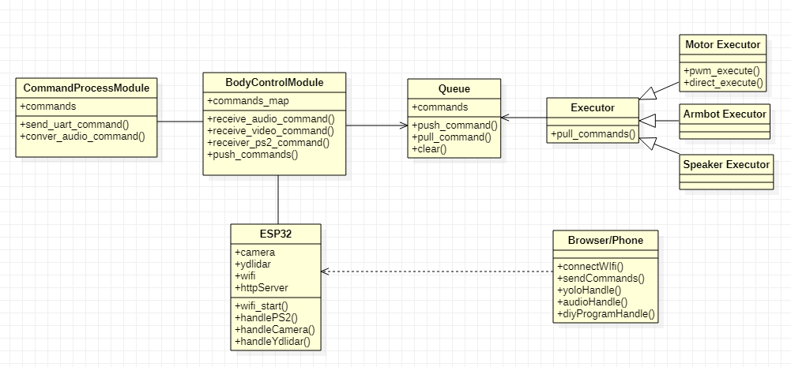

# 1 整体软件架构
> 统一接口文档（OpenAPI 3.0 / Swagger）：[api.yaml](api.yaml)，按 Pi Edge Server、Center Server、ROS Health Gateway、Body Control (UART) 分组。
RushMog智能系统包括语音控制系统，车体控制系统，视觉分析系统，远程控制中心系统、激光雷达系统、VLA推理系统、机械臂系统、SLAM/导航/目标搜索系统等核心子系统。
- 语音控制系统，识别语音，将语音转换成执行指令，并将指令传给主控制系统，进行控制执行。(原计划采用asr-pro车载控制，但小车电机噪音较大，效果不好。改用终端控制。)
- 语音播报/录音系统。Edge Server 自动连接 newmine 蓝牙音箱（BlueZ + PipeWire A2DP），通过 `espeak-ng` 中文 TTS 或本地音频文件播报；同一设备的 HFP 麦克风支持录音，录音时自动切 HFP、停止后恢复 A2DP。HTTP `/api/speaker/*`、`/api/microphone/*`、ROS `/body/say`、`/edge/audio` 和 dashboard 面板均可使用。
- 车体控制系统，STM32单板控制，接收语音指令、PS2手柄指令对小车行进、声音、机械臂进行控制执行。
- 远程控制中心系统，由 Pi Edge Server 提供 Wi-Fi AP（hostapd）、PS2 手柄页面、摄像头 MJPEG 图传、底盘串口桥和模拟手柄指令；网页/API 与 ROS2 同机运行。
- 激光雷达系统。`edge_server` 内置 `lidar_node`（LD19/D6 47 字节协议，UART4 `/dev/rush_lidar`）发布 `/scan` 和 `base_link→laser_link` TF；`slam_toolbox` 建图，`AMCL` 定位。硬件方案见 [hardware/SLAM_NAV.md](../hardware/SLAM_NAV.md)。
- VLA推理系统。由 `software/center_server` 的 SmolVLA HTTP 服务执行真实策略推理；机载 ROS 负责采集、安全门控与执行，规则桩保留为降级路径。
- 机械臂系统。PCA9685 驱动，`/arm/trajectory` 接口；抓取/放置轨迹待 IK 接入。
- SLAM/导航/目标搜索系统。由 `software/edge_server` 的 ROS 包 `edge_server` 实现：建图、定位健康度、Nav2/直航、目标检测、前沿探索、目标确认与接近。
- 电源监控系统。树莓派 Edge Server 读取 `vcgencmd get_throttled` 与 `rpi_volt`，通过 `/api/power`、`/body/power_status` 和 dashboard「电源及转换板」模块展示欠压/降频/温度状态；当前正常即表示电源及转换板正常。
- 健康检查系统。由 `software/edge_server` 的 `health_monitor_node` 实现：ROS 节点/话题 + 相机/雷达/IMU/麦克风/音箱/机械臂/底盘/电池等设备健康，HTTP 供同机 Edge Server/dashboard 代理。

> **计算平台说明**：ESP32 与树莓派模块已合并，Wi-Fi/网页/底盘串口与 ROS2/slam_toolbox/Nav2 全部由机载树莓派 Edge Server（`software/edge_server`）承担；旧 ESP32 固件已移除。
> SLAM/导航/目标搜索必须在机载树莓派 4B/5 或 Jetson Orin Nano 上运行。

# 2 控制指令

| 语音命令      | 手柄命令              | 功能                         | 命令ID |    指示灯|
| ------------ | --------------------- | -------------------------- | ------ | ------  |
| 停/别走了     | 松开左侧所有按钮       | 小车停止                      |  0     |         |
| 前进/走      | ↑ 键，或左摇杆向上      | 小车前进                      |  1     |         |
| 后退         | ↓ 键，或左摇杆向下      | 小车后退                      |  2     |         |
| 往左走       | ← 键，或左摇杆向左      | 小车向左横向走                 |  3     |         |
| 往右走       | → 键，或左摇杆向右      | 小车向右横向走                 |  4     |         |
| 往左前走     | 左摇杆向左上            | 小车向左前方向斜着走            |  5     |         |
| 往右前走     | 左摇杆向右上            | 小车向右前方向斜着走            |  6     |         |
| 往左后走     | 左摇杆向左下            | 小车向左后方向斜着走            |  7     |         |
| 往右后走     | 左摇杆向右下            | 小车向右后方向斜着走            |  8     |         |
| 左转         | L1按钮                 | 小车向左转                     | 9     |         |
| 右转         | R1按钮                 | 小车向右转                     | A     |         |
| 左调头       | L2按钮                 | 小车从左侧调头                 | B     |         |
| 右调头       | R2按钮                 | 小车从右侧调头                 | C     |         |
| 测试小车     | START 键               | 测试小车                       | D     |         |
|             |  △ 键                 | 加速                           | E     |         |
|             |  × 键                  | 减速                           | F     |         |
|             |  □ 键                  | 向左微转                       | G     |         |
|             |  ○ 键                  | 向右微转                       | H     |         |
|             |  松开 □ 或 ○ 键        | 恢复直行                        | I     |         |
|             |  SELECT 键             | 小车重新初始化                  | J     |         |

# 3 子系统设计说明
## 3.1 语音控制子系统
原计划采用 asr-pro 车载语音控制；因电机噪声导致识别效果不佳，语音输入改由终端/手机页面完成，原 `audio_control` 代码已移除。

语音**输出**由 `edge_server` 的 `SpeakerManager` 负责：自动连接蓝牙音箱、PipeWire A2DP 输出、espeak-ng 中文 TTS/本地音频排队播放；详见 [edge_server/README.md](edge_server/README.md) §5.6。

## 3.2 车体控制子系统

[车体控制系统](body_control/README.md)

车体控制子系统功能：
- 1 接收语言控制指令
- 2 驱动小车电机，四个电机分别驱动，能够实现前进/后退/停止等动作
- 3 与树莓派/摄像头交互，传递控制指令，接收图像分析结果
- 4 驱动机械臂运动控制执行

> 当前 STM32 固件使用 ASCII 命令协议，并通过 USART3 周期回传 `$B,...` 四轮编码器遥测；
> Pi 上的 `edge_server_node` 已直接接入并发布 `/odom`、`/joint_states`、`/base/status`。
> `edge_server` 另保留二进制协议主机侧（`base_protocol.py` / `base_bridge_node`），
> 升级固件（4 路独立 PWM + 轮速 PID + 二进制帧）后可切换以获得更平滑的闭环。

## 3.3 远程控制子系统
- [Pi Edge Server / ROS 包](ros/README.md)
- [数字孪生监控页](ros/web/dashboard.html)（`/dashboard.html`）
- [ROS/CENTER 自动接入与上报](tools/README.md)

远程控制子系统功能：
- 1 树莓派 Edge Server 提供 Wi-Fi AP、网页手柄、静态资源和 MJPEG 图传
- 2 连接摄像头，实时采集图像数据并做机器学习识别
- 3 网页手柄/摇杆与 ROS `/cmd_vel` 经同一 STM32 串口出口仲裁下发
- 4 STM32 `$B` 编码器遥测 -> `/odom`、`/base/status`、dashboard BODY 面板
- 5 模块注册/上报/代理 API，展示 EDGE（含 ROS）/CENTER 状态并支持参数修改

## 3.4 中心推理子系统
- 机载 ROS 包（SLAM/导航/搜索/安全/健康检查）：[ros/README.md](ros/README.md)、[详细设计](ros/DESIGN.md)、[健康检查契约](ros/HEALTHCHECK.md)
- 中心 SmolVLA HTTP 推理服务：[center_server/README.md](center_server/README.md)、[服务设计](center_server/DESIGN.md)

中心推理子系统功能：
- 1 接收端侧/机载多模态数据（图像、激光、音频、里程计、IMU、地图、定位）
- 2 SmolVLA 推理，输出动作块、底盘速度和机械臂动作
- 3 SLAM 建图/地图存取、定位健康度、Nav2/直航导航
- 4 目标检测、前沿探索、目标确认与接近
- 5 多源速度仲裁、安全门控、反向操作
- 6 中心服务与机载 ROS 通过 HTTP 解耦，可分别部署和降级
- 7 节点/设备健康检查，HTTP `:8090/ros/health` 供同机 Edge Server/dashboard 代理

验证：ROS 包 94 项单元测试（含 29 项健康检查）、7/7 VLA/安全端到端、
6/6 SLAM/导航/搜索联调；`center_server` 服务 38 项单元/HTTP 测试（不依赖 GPU）。

# 4 使用的相关工具软件：

#### OS： Ubuntu 20.04

#### 软件设计开发工具:

- 软件设计工具： StarUML  https://staruml.io/download

