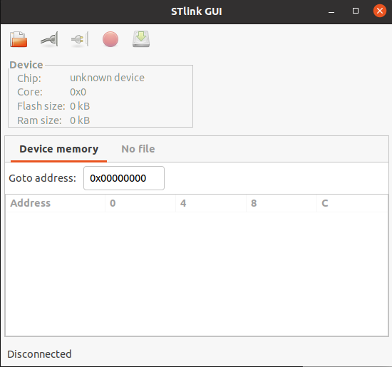

# 开发环境说明

## IDE等
- 开发IDE： VSCODE

- 编译软件： arm-none-eabi-gcc, cmake

ubuntu下安装： apt install arm-none-eabi-gcc

- 烧录软件1: stlink
```shell
# 安装依赖
$ sudo apt-get install libusb-1.0
$ sudo apt-get install cmake
$ sudo apt-get install libgtk-3-dev
$ sudo apt install libreadline-dev

# 安装JLink
$ sudo apt install stlink-tools
$ sudo apt install stlink-gui


$ st-flash --version
        v1.7.0

```
## 编译
```shell
$ mkdir build
$ cd build
$ cmake -G "Unix Makefiles" -D "CMAKE_TOOLCHAIN_FILE=../CMake/GNU-ARM-Toolchain.cmake" ..
$ make
$ ll src
total 1.0M
drwxrwxr-x  3 eagle 4.0K 6月  11 23:15 .
drwxrwxr-x  6 eagle 4.0K 6月  11 23:15 ..
-rwxrwxr-x  1 eagle  18K 6月  11 23:15 body_control.bin
-rwxrwxr-x  1 eagle 360K 6月  11 23:15 body_control.elf
-rw-rw-r--  1 eagle  51K 6月  11 23:15 body_control.hex
-rw-rw-r--  1 eagle 433K 6月  11 23:15 body_control.lss
-rw-rw-r--  1 eagle 213K 6月  11 23:15 body_control.map
drwxrwxr-x 11 eagle 4.0K 6月  11 23:15 CMakeFiles
-rw-rw-r--  1 eagle 1017 1月  14 08:26 cmake_install.cmake
-rw-rw-r--  1 eagle  27K 1月  14 08:26 Makefile
```

## 烧录
方式一： ST-LINK
```
$ cd src
$ sudo st-flash write body_control.bin 0x8000000

$ 如果在wsl中执行烧录，需要的windows terminal中执行：
   1 usbipd list
   2 usbipd bind --busid 2-4
   3 usbipd attach --wsl --busid 2-4
```
或者打开st-link软件，点击连接，选择body_control.bin文件，点击烧录按钮。


```
完成烧录后再将boot0跳线改回置0

## 依赖
依赖： python3, python-pip3, python serial

安装python serial: https://www.geeksforgeeks.org/how-to-install-python-serial-package-on-linux/

如果执行报错： usr/bin/env: ‘python’: No such file or directory

执行以下命令解决： sudo ln -s /usr/bin/python3 /usr/bin/python

- 串口调试工具： VS Code Serial Monitor插件


## 悬崖保护（TCRT5000 ×2）

车身左前、右前各装一只 TCRT5000 红外反射悬崖模块，只使用模块的 DO 数字量输出：

| 模块 | 模块引脚 | STM32 引脚 | 说明 |
| --- | --- | --- | --- |
| 左前悬崖 | VCC | 3.3V | 推荐 3.3V；5V 模块也可，PB3 为 5V 容忍 |
|  | GND | GND | 必须与 STM32 共地 |
|  | DO | PB3 | 左前检测 |
| 右前悬崖 | VCC | 3.3V | 推荐 3.3V；5V 模块也可，PB4 为 5V 容忍 |
|  | GND | GND | 必须与 STM32 共地 |
|  | DO | PB4 | 右前检测 |

行为：

- `cliff_sensor.c` 每 10ms 采样一次 PB3/PB4，连续 3 次一致才更新状态（约 30ms 消抖，最坏约 40ms 停车）。
- 任一模块触发：立即清空命令队列、封锁运动并写 STOP；触发期间只允许停车 `0` 和后退 `2`，前进、横移、转向、测试序列都会被改成停车。
- 传感器恢复（通常是已经后退离开悬崖）后自动解除封锁，恢复遥控/ROS 控制。
- 没有使用 EXTI：EXTI3/EXTI4 已被 PA3/PA4 编码器占用。

接线与标定注意：

- PB3/PB4 复位后默认是 JTAG 的 JTDO/NJTRST。`cliff_sensor_init()` 会关闭 JTAG、保留 SWD，ST-Link 仍可通过 PA13/PA14 烧录调试，但不要再使用 JTAG 方式连接。
- TCRT5000 的 DO 是电位器阈值比较输出，不能测距。要得到约 10cm 的停车余量，应把探头朝前下方倾斜，让红外光斑落在车头前方约 10cm 的地面上，再用模块电位器把该距离调到刚好触发；光斑越过桌沿时模块翻转，固件读到触发后立刻停车。
- 默认按“悬崖模式”配置：`CLIFF_LEFT_TRIGGER_LEVEL` / `CLIFF_RIGHT_TRIGGER_LEVEL` 均为 `1`（高电平触发，即无反射=高）。如果模块 DO 为低电平有效（常见于前向避障），把对应宏改成 `0`；两个模块可以独立配置。宏在 `src/inc/cliff_sensor.h`。
- 上电自检：把车放在桌面上，模块朝前下方看地面，此时应处于“不触发”状态；把模块移到桌沿外应翻转触发。若上电后放在桌面上就不能前进，说明 DO 空闲电平与默认配置相反，先检查电位器，仍相反则改上面的触发宏。

> 新增 `cliff_sensor.c` 后，已有的 build 目录需要重新执行一次 `cmake ..` 再 `make`，否则 `aux_source_directory` 不会自动收录新源文件。


# 问题与注意事项
- 1 中控的中断优先级一定要设置正确，否则有诡异问题。UART2的中断优先级要低于configLIBRARY_MAX_SYSCALL_INTERRUPT_PRIORITY配置（即数字比这个大）。另外一定要加这句：
```C
NVIC_PriorityGroupConfig(NVIC_PriorityGroup_4);           /* 设置优先级分组为4组，即抢占优先级范围为0-15 */
```
- 2 使用串口工具进行命令下发调试时，注意一定要在命令后面带上换行符，因为命令接收以换行符为结束标识，没有换行符会一直收集命令。

# 参考
https://github.com/larriti/stm32f10x-template

https://github.com/erhankur/stm32f103-bluepill


# CMake-based STM32F103C8 Template (Blue Pill)
---
Based on https://github.com/ahessling/STM32F4Template

As an addition;
* style fixer tool (astyle) can be use with `./code-format.sh`
* `make monitor` will open picocom serial terminal
---
### Build
```
./build.sh
cd build
make
```
### Download binary
```
make flash  # this will run openocd if it is found during cmake process
```
### Serial terminal
```
make monitor # this will run picocom with 115200 8N1
```
Of course you can run all commands in one shot

`make flash monitor`

### Debug
```
make gdb # this will run gdb and openocd in the background.

todo: kill openocd upon gdb termination
```

