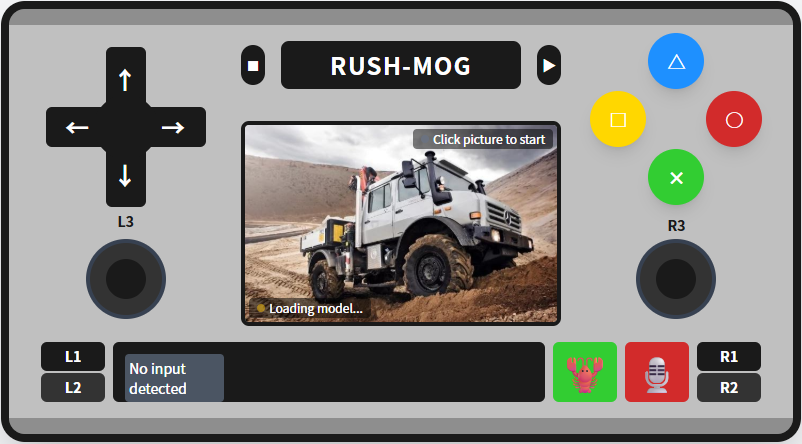

# 远程控制中心说明
远程控制中心是基于ESP32-S3实现的网页版手柄控制，ESP32-S3通过 UART1（GPIO19=TX、GPIO20=RX）连接主控 STM32 的 USART3，将操作指令下发到主控，进而控制小车。
使用手机或其他移动设备连接ESP32-S3的WIFI，使用网页进行操作。

## 功能特性
- **实时视频流**: 通过摄像头实时传输视频画面
- **YOLO物体识别**: 支持实时物体检测，自动框选并标注物体名称和置信度
- **语音控制**: 支持语音识别，通过语音命令控制小车
- **手柄控制**: 完整的PS2风格虚拟手柄控制
- **数字孪生监控**: `dashboard.html` 展示 EDGE / ROS / CENTER 模块状态、设备矩阵、BODY CONTROL 电机/速度/里程和参数配置

## 端口说明
- `80`：网页、静态文件、`/sdcard/*`、`/cmd`（控制）、`/stop`、`/status`、`/api/modules*`（监控/配置）
- `8080`：独立 MJPEG 视频流（与 HTTP 80 分离，避免推流阻塞控制）

> 摄像头模块当前默认禁用：`include/camera.h` 中的 `ENABLE_CAMERA = 0`。
> 禁用时不会初始化摄像头、不会占用摄像头引脚，也不会监听 8080；
> 需要恢复视频流时把它改成 `1`（或在 `build_flags` 里加 `-DENABLE_CAMERA=1`）
> 重新编译即可（camera 源码均保留）。

`/status` 返回 JSON，包含运行时间、剩余堆/PSRAM、摄像头/SD 状态和当前是否有持续运动（`motion_active`）。

控制通道直接复用网页的 80 端口，用 `POST /cmd` 发送纯文本命令（`button:up:down`、`stick:left-analog:up:5`），不再占用 81 端口。浏览器只在按下/松开（摇杆为按下/拖动/松开）时发命令，按住期间不再发心跳；ESP32 默认每 200ms 把当前运动命令重发给 STM32（dashboard 可调 100–600ms），用来喂 STM32 的 800ms 看门狗，直到收到松开/停止命令。

ROS2 通过 `POST /cmd` 的 `raw:<command>` 走同一条链路，例如 `raw:15`（前进、PWM 档 5）、`raw:95`（左转、PWM 档 5）。raw 命令会保留第二字节并每 200ms 重发，同时带 1s 租约：ROS 停止续租后 ESP32 自动停车。车身编码器遥测通过 `GET /api/body` 提供给 ROS2。

调试时可以直接用 curl 发命令（按住类命令会一直保持，直到发送停止命令）：

```bash
curl -X POST --data 'button:up:down' http://192.168.4.1/cmd
curl -X POST --data 'button:stop:down' http://192.168.4.1/cmd
```

松手、页面隐藏或关闭时页面会发停止命令。如果手机与 ESP32 断网且页面没有机会发停止，ESP32 会保持最后一条运动命令；重新打开页面（加载时会自动置停）或 `POST /stop` 即可停车。

# 上位机监控与配置（数字孪生）
手柄页顶部的 **RUSH-MOG TWIN** 按钮会打开 `dashboard.html`：

- 以 RUSH-MOG 数字孪生车辆为中心，显示 EDGE / ROS / CENTER 三个模块和
  摄像头、雷达、IMU、麦克风、音箱、机械臂、底盘、电池、里程计状态；
- 点击模块“参数”打开参数抽屉，支持修改后立即生效；
- ROS / CENTER 的信息由它们连接 RUSH-MOG Wi-Fi 后主动上报到 `192.168.4.1`，
  页面只访问 ESP32，由 ESP32 代理模块接口，避免手机跨域/AP 客户端隔离问题。
  若 ESP32 主动访问 AP 客户端被网络策略阻止，页面会回退为直连模块地址；
  直连也失败时仍可显示最近一次上报的缓存状态。

## 模块上报与代理 API

| 方法 | 路径 | 说明 |
|---|---|---|
| POST | `/api/modules/report` | ROS / CENTER 上报模块、状态、精简参数（表单） |
| GET | `/api/modules` | 模块注册表 + Edge 自身状态/参数（含 `edge.body` 编码器遥测） |
| GET | `/api/body` | STM32 编码器遥测快照（四轮 mm/s、总里程 mm、年龄/新鲜度） |
| GET | `/api/modules/{id}` | 单个模块缓存 |
| GET | `/api/modules/{id}/health` | 代理模块健康接口（如 ROS `/ros/health`） |
| GET | `/api/modules/{id}/params` | 代理/本地参数描述 |
| POST | `/api/modules/{id}/params` | 代理/本地参数修改 |

- `{id}`：`edge` / `ros` / `center`；`edge` 由 ESP32 本地处理；
- ESP32 用连接来源 IP 作为模块地址，模块只上报端口和路径；
- 模块上报示例（`edge_link.py` 自动完成）：

```bash
curl -X POST http://192.168.4.1/api/modules/report \
  -d 'module=ros' \
  -d 'name=ROS 2 center_server' \
  -d 'version=0.2.0' \
  -d 'status=ok' \
  -d 'summary=all devices ok' \
  -d 'health_port=8090' -d 'health_path=/ros/health' \
  -d 'params_port=8090' -d 'params_path=/ros/params' \
  -d 'params_json={"publish_rate":1.0,"device_count":9}'
```

## 边缘参数（NVS 持久化）

`GET/POST /api/modules/edge/params` 暴露 Edge 自身参数：

| 参数 | 范围 | 说明 |
|---|---|---|
| `motion_keepalive_ms` | 100–600 | STM32 运动保活周期；必须小于 800ms 看门狗 |
| `stream_fps` | 5–20 | MJPEG 推流帧率 |

只读信息包括 `ap_ssid`、`ap_ip`、`ap_channel`、`max_clients`、`wifi_clients`、
`free_heap`、`free_psram`、`uptime_ms`、`camera`、`sdcard`、`motion_active`。

> AP 最大客户端数已提升到 **4**（`AP_MAX_CLIENTS`）：手机 + ROS + CENTER + 调试机。
> 需要至少 3 个客户端才能同时完成监控、控制和两个模块上报。

ROS / CENTER 侧自动连接 Wi-Fi 并上报的部署说明见
[`software/tools/README.md`](../tools/README.md)。


# 控制按键说明
左侧8方向按钮，提供8个方向指令。同时在上方提供左转、右转、快速调头按钮。按钮按下触发，松开停止。
右侧4方向按钮，上下方向为加减速，点击生效，实现速度加减一档。 左右按钮为调方向按钮，通过PWM进行方向微调，按钮按下触发，松开恢复相同PWM。
中间部分提供速度展示框。



# 语音控制使用说明
## 功能介绍
系统支持通过语音识别来控制小车，使用浏览器的Web Speech API实现语音转文字，然后将识别结果转换为控制指令。支持中英文语音命令。

浏览器中设置麦克风权限：
chrome://settings/content/microphone

edge://settings/privacy/sitePermissions/allPermissions/microphone

## 使用方法
1. **启用语音控制**: 点击底部🎙️按钮（蓝色）开启语音识别
2. **说出命令**: 清晰地说出控制命令
3. **查看状态**: 状态栏会显示识别结果和执行的动作

## 支持的语音命令

### Edge浏览器配置
因为麦克风需要https才能使用，因此需要特殊配置权限才可以用。
打开edge浏览器输入： edge://flags/#unsafely-treat-insecure-origin-as-secure
在 Insecure origins treated as secure 项的可用栏中输入 http://192.168.4.1，并设置已可用。
打开edge浏览器输入：http://192.168.4.1   点击地址左侧不安全项，选择 此网站权限/麦克风 —> 已允许。

### 方向控制
| 中文命令 | 英文命令 | 功能 |
|---------|---------|------|
| 前进 | forward / go | 向前移动 |
| 后退 | backward / back | 向后移动 |
| 向左 | left | 向左移动 |
| 向右 | right | 向右移动 |
| 停止 / 停 | stop | 停止所有动作 |

### 动作按钮
| 中文命令 | 英文命令 | 功能 |
|---------|---------|------|
| 三角 | triangle | 按下三角键 |
| 方块 | square | 按下方块键 |
| 圆形 | circle | 按下圆形键 |
| 叉 / X | cross / x | 按下叉键 |

### 肩键和功能键
| 命令 | 功能 |
|------|------|
| L1 / R1 / L2 / R2 | 按下对应肩键 |
| 开始 / start | 按下开始键 |
| 选择 / select | 按下选择键 |

## 注意事项
- 语音识别需要麦克风权限，请允许浏览器访问麦克风
- 建议在安静环境下使用，以提高识别准确率
- 支持Chrome、Edge、Firefox等现代浏览器
- 语音控制开启后会自动持续监听，再次点击按钮可关闭

# YOLO物体识别使用说明
## 功能介绍
系统集成了基于TensorFlow.js的COCO-SSD物体检测模型，可在浏览器端实时识别视频流中的物体。支持识别80种常见物体类别，包括：
- 人物(person)、车辆(car, truck, bus)、动物(cat, dog, bird)等
- 日常物品(cell phone, cup, chair, table)等

## 使用方法
1. **开启摄像头**: 点击顶部"RUSH-MOG"Logo启动视频流
2. **启用YOLO**: 点击底部右侧的🎯按钮（绿色）开启物体识别
3. **查看检测结果**: 
   - 识别到的物体会被彩色方框标记
   - 方框上方显示物体类别和置信度（如"person 85%"）
   - 左下角状态栏显示当前检测到的物体信息

## ⚠️ 离线使用重要说明
由于ESP32的LittleFS存储空间有限（16MB），无法存储完整的AI模型文件（约5-10MB）。COCO-SSD模型需要从外部服务器下载权重文件。

### 解决方案：

#### 方案一：预先缓存模型（推荐）
1. 首次使用时，将设备连接到互联网
2. 打开网页，点击YOLO按钮加载模型
3. 模型会被浏览器缓存，之后可以在离线环境使用
4. 浏览器缓存位置：
   - Chrome: `chrome://settings/siteData`
   - 缓存通常在IndexedDB中

#### 方案二：部署模型到本地服务器
1. 下载COCO-SSD模型文件到本地服务器：
   ```
   模型地址: https://storage.googleapis.com/tfjs-models/savedmodel/ssd_lite_mobilenet_v2/
   需要下载的文件:
   - model.json
   - group1-shard1of1.bin (权重文件)
   ```
2. 修改`data/index.html`中的模型加载代码：
   ```javascript
   // 将模型URL改为您的本地服务器地址
   yoloModel = await cocoSsd.load({ 
       modelUrl: 'https://your-local-server.com/models/ssd_lite_mobilenet_v2' 
   });
   ```

#### 方案三：使用手机热点
1. 用手机开启热点并连接ESP32
2. 手机同时保持移动数据/WiFi连接互联网
3. 首次加载模型后，浏览器会缓存模型文件

### 注意事项
- 首次开启YOLO时需要下载模型文件（约5MB），请耐心等待"Loading model..."完成
- 物体识别在浏览器端运行，会消耗一定的设备性能
- 如果模型加载失败，会弹出详细的错误信息和解决方案
- 关闭视频流时，YOLO会自动停止检测
- 建议使用Chrome浏览器，其对TensorFlow.js支持最好
# 开发环境搭建说明

```
步骤 1：安装必要的工具
安装VS Code
安装Python 3.7+（确保勾选 "Add Python to PATH"）
安装 Git（Windows / Mac）

步骤 2：安装 PlatformIO 插件
打开 VS Code
进入扩展面板（左侧菜单或 Ctrl+Shift+X）
搜索 "PlatformIO" 并安装

步骤 3：开发编译：
点击vscode最下侧 √ 按钮进行编译。（或用 ctrl + alt + B 快捷键）

步骤 4：上传网页文件
打开左侧在插件安装下方的PlatformIO头像图标，在 di_mini/platform 中选择 "Upload Filesystem Image" 进行执行，上传 `data/` 下的 index.html、dashboard.html、dashboard.css、dashboard.js 等文件。

步骤 5: 烧录程序
将ESP8266板子使用USB线连接到电脑。
点击vscode最下侧 -> 按钮进行编译。

步骤 6：监控串口
点击vscode最下侧 插头图标的 Serial Monitor 按钮进行编译。

步骤 7：手机连接wifi进行页面访问
在手机WIFI中找到RUSH-MOG，连接后，打开浏览器，输入192.168.4.1，即可访问到页面。

```